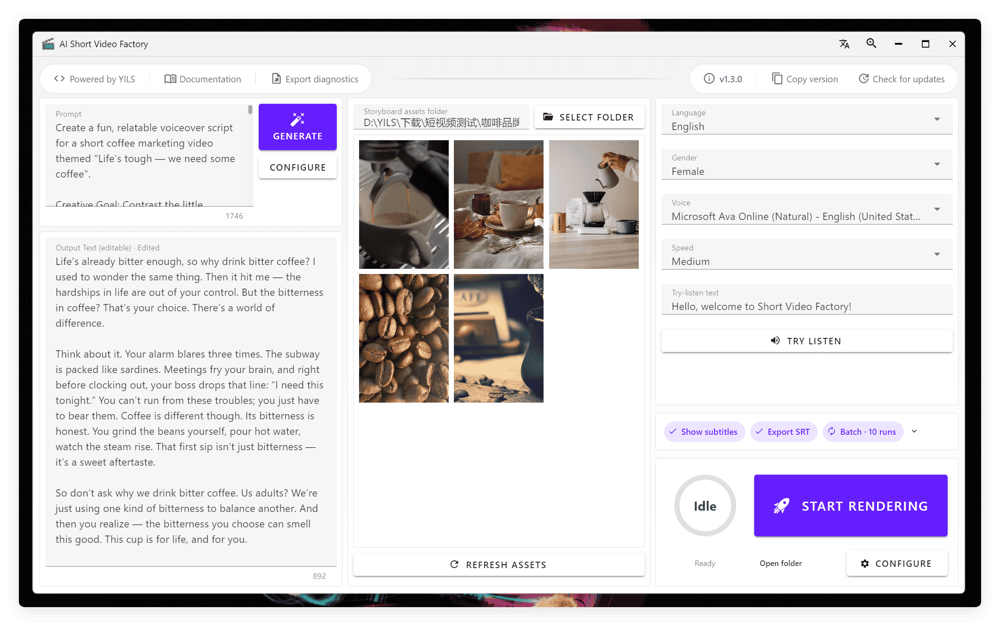
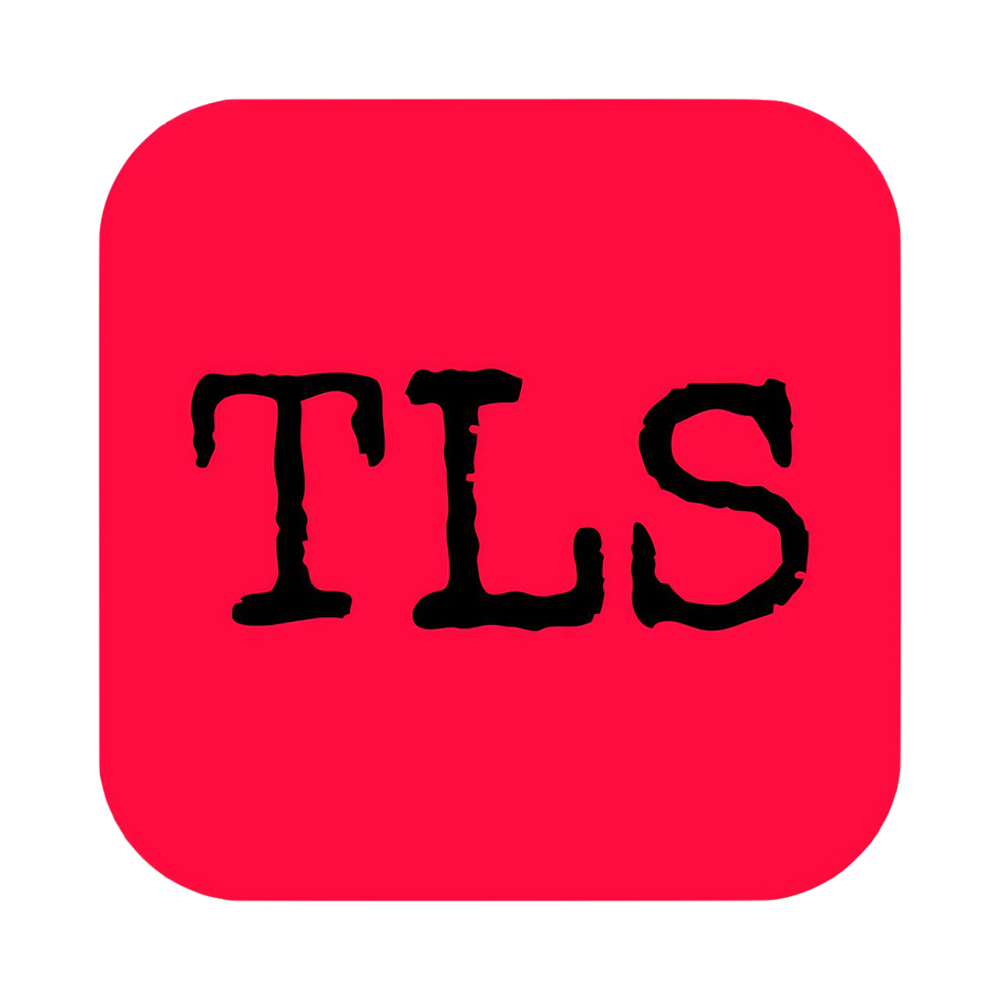

  <a href="./README.md">简体中文</a> | <strong>English</strong>

<!-- Project screenshot -->

  

---

<!-- Project logo -->
 

  

<h3 align="center">AI Short Video Factory</h3>

  

    🚀 Create product marketing and general-interest short videos in one click with AI-powered batch editing in a polished, cross-platform desktop app
  

  <!-- Project badges -->

[![Contributors][contributors-shield]][contributors-url]
[![Forks][forks-shield]][forks-url]
[![Stars][stars-shield]][stars-url]
[![Issues][issues-shield]][issues-url]
[![Latest Release][release-shield]][release-url]

<!-- ![Release Date][release-date-shield] -->

[![License][license-shield]][license-url]

  

    <a href="https://github.com/YILS-LIN/short-video-factory/issues/new?labels=bug&template=bug-report---.md">Report a Bug</a>
    &middot;
    <a href="https://github.com/YILS-LIN/short-video-factory/issues/new?labels=enhancement&template=feature-request---.md">Request a Feature</a>
  

<!-- About the project -->

## 📖 About the Project

AI Short Video Factory is an open-source desktop application designed to simplify short video production with AI. With a simple text prompt and video clips for each scene, users can quickly and automatically edit high-quality product marketing and general-interest short videos. The project brings together AI-powered script generation, speech synthesis, video editing, and subtitle effects to deliver an out-of-the-box video creation experience.

### Key Features

- 🤖 **AI-Powered**: Integrates the latest AI technologies to improve video production efficiency and quality
- 📝 **Script Generation**: Generates high-quality short video scripts from prompts
- 🎥 **Automated Editing**: Supports multiple video formats and automates batch video editing tasks
- 🎙️ **Speech Synthesis**: Converts generated scripts into natural-sounding speech
- 🎬 **Subtitle Effects**: Automatically adds subtitles and effects to enhance videos
- 📦 **Batch Processing**: Supports batch tasks that continuously render videos using presets
- 🌐 **Multilingual Support**: Supports Chinese, English, and other languages to meet different user needs
- 📦 **Ready to Use**: Get started quickly without complicated configuration
- 📈 **Regular Updates**: New releases include bug fixes and new features
- 🔒 **Secure and Reliable**: Runs locally to keep user data secure
- 🎨 **User-Friendly**: A clean, intuitive interface that is easy to use
- 💻 **Cross-Platform**: Supports Windows, macOS, and Linux

(<a href="#readme-top">Back to top</a>)

## 🚀 Getting Started

Download the latest version from [GitHub Releases](https://github.com/YILS-LIN/short-video-factory/releases).

Visit the [official documentation](https://short-video-factory.yils.blog) for the user guide.

(<a href="#readme-top">Back to top</a>)

## 🗺️ Roadmap

**If you like this project, please give it a Star!**

Implemented and planned features:

- [x] Script generation with support for the OpenAI-compatible API format
- [x] Speech synthesis with EdgeTTS support
- [x] Video editing that combines scripts, video, audio, and subtitles with automated clip mixing
- [x] Batch processing with a batch task that continuously renders videos using presets
- [x] Multilingual support, including Chinese and English
- [x] Comprehensive user guide
- [ ] More detailed parameter controls
- [ ] More speech synthesis APIs
- [ ] Subtitle effects with multiple styles and effects

See the [open issues](https://github.com/YILS-LIN/short-video-factory/issues) for a full list of proposed features and known issues.

(<a href="#readme-top">Back to top</a>)

## 🎞️ Example Videos

<table>
<thead>
<tr>
<th align="center"><g-emoji class="g-emoji" alias="arrow_forward">▶️</g-emoji> Product Marketing Short Video</th>
<th align="center"><g-emoji class="g-emoji" alias="arrow_forward">▶️</g-emoji> Heartwarming and Uplifting Quotes</th>
</tr>
</thead>
<tbody>
<tr>
<td align="center"><video src="https://github.com/user-attachments/assets/3ac899b7-b1aa-4ffc-adc2-fb4b38ca0591"></video></td>
<td align="center"><video src="https://github.com/user-attachments/assets/b58b1fa1-748a-4ebe-9134-4c0a72d59a48"></video></td>
</tr>
</tbody>
</table>

Note: The source footage was collected online and is used solely to demonstrate the editing results.

(<a href="#readme-top">Back to top</a>)

<!-- Contributing -->

## 🤝 Contributing

Contributions make the open-source community an amazing place to learn, find inspiration, and create. Any contributions you make are **greatly appreciated**.

If you have a suggestion to improve this project, please fork the repository and create a pull request. You can also open an issue with the "enhancement" label.
Don't forget to give the project a Star! Thank you for your support!

1. Fork the project
2. Create your feature branch (`git checkout -b feature/AmazingFeature`)
3. Commit your changes (`git commit -m 'Add some AmazingFeature'`)
4. Push to the branch (`git push origin feature/AmazingFeature`)
5. Open a pull request

### Top Contributors

(<a href="#readme-top">Back to top</a>)

## 💖 Acknowledgments

- [rany2/edge-tts](https://github.com/rany2/edge-tts)
- [duyquangnvx/edge-tts](https://github.com/duyquangnvx/edge-tts)

(<a href="#readme-top">Back to top</a>)

<!-- License -->

## 🎗 License

[![License][license-shield]][license-url]

Copyright © 2025 YILS.

(<a href="#readme-top">Back to top</a>)

## 🐱 Donate

If you find this project helpful, consider buying the author a coffee (or a beer) 🍺

Your **Stars ⭐** and **donations** are my biggest motivation to keep improving the project!

  

👉 View the donor list here: [Donor Wall — Messages from Supporters](https://short-video-factory.yils.blog/donate/list.html)

(<a href="#readme-top">Back to top</a>)

<!-- Star history -->

## ⭐ Star History

<a href="https://star-history.dera.page/#YILS-LIN/short-video-factory">
 <picture>
   <source media="(prefers-color-scheme: dark)" srcset="https://star-history.dera.page/svg?repos=YILS-LIN/short-video-factory&theme=dark" />
   <source media="(prefers-color-scheme: light)" srcset="https://star-history.dera.page/svg?repos=YILS-LIN/short-video-factory" />
   
 </picture>
</a>

(<a href="#readme-top">Back to top</a>)

<!-- Markdown links and images -->

[contributors-shield]: https://img.shields.io/github/contributors/YILS-LIN/short-video-factory.svg?color=c4f042&labelColor=black&style=flat-square
[contributors-url]: https://github.com/YILS-LIN/short-video-factory/graphs/contributors
[forks-shield]: https://img.shields.io/github/forks/YILS-LIN/short-video-factory.svg?color=8ae8ff&labelColor=black&style=flat-square
[forks-url]: https://github.com/YILS-LIN/short-video-factory/network/members
[stars-shield]: https://img.shields.io/github/stars/YILS-LIN/short-video-factory.svg?color=ffcb47&labelColor=black&style=flat-square
[stars-url]: https://github.com/YILS-LIN/short-video-factory/stargazers
[issues-shield]: https://img.shields.io/github/issues/YILS-LIN/short-video-factory.svg?labelColor=black&style=flat-square
[issues-url]: https://github.com/YILS-LIN/short-video-factory/issues
[release-shield]: https://img.shields.io/github/v/release/YILS-LIN/short-video-factory?labelColor=black&style=flat-square
[release-url]: https://github.com/YILS-LIN/short-video-factory/releases
[release-date-shield]: https://img.shields.io/github/release-date/YILS-LIN/short-video-factory?color=9cf&style=flat-round
[license-shield]: https://img.shields.io/github/license/YILS-LIN/short-video-factory.svg?labelColor=black&style=flat-square
[license-url]: https://github.com/YILS-LIN/short-video-factory/blob/main/LICENSE
