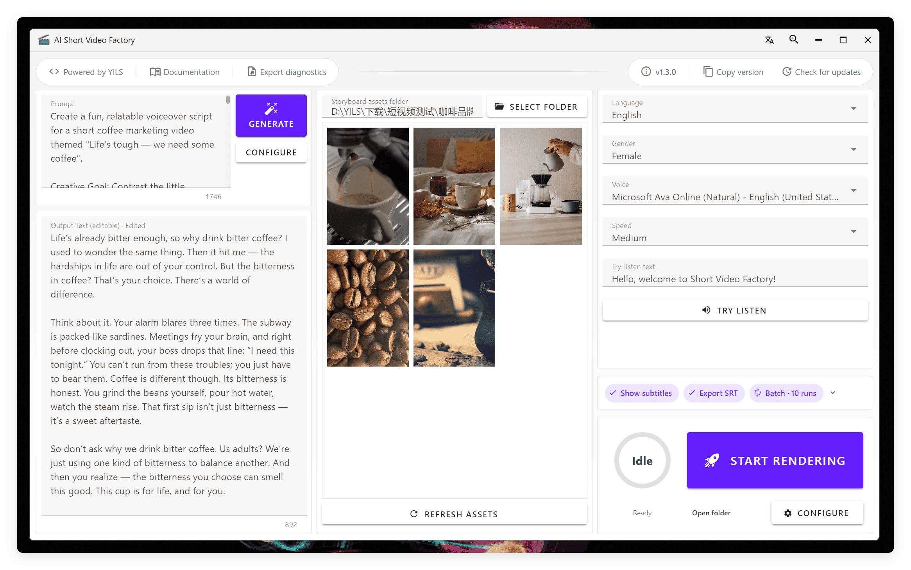

  <a href="./README.md">简体中文</a> | <a href="./README.en.md">English</a> | <strong>日本語</strong>

<!-- Project screenshot -->

  

---

<!-- Project logo -->
 

  

<h3 align="center">AI Short Video Factory</h3>

  

    🚀 洗練されたクロスプラットフォームのデスクトップアプリで、AI による一括編集を使い、商品マーケティング動画や一般向けの短尺動画をワンクリックで作成
  

  <!-- Project badges -->

[![Contributors][contributors-shield]][contributors-url]
[![Forks][forks-shield]][forks-url]
[![Stars][stars-shield]][stars-url]
[![Issues][issues-shield]][issues-url]
[![Latest Release][release-shield]][release-url]

<!-- ![Release Date][release-date-shield] -->

[![License][license-shield]][license-url]

  <a href="https://www.star-history.com/yils-lin/short-video-factory">
    <picture>
      <source media="(prefers-color-scheme: dark)" srcset="https://api.star-history.com/badge?repo=YILS-LIN/short-video-factory&type=trending&theme=dark" />
      <source media="(prefers-color-scheme: light)" srcset="https://api.star-history.com/badge?repo=YILS-LIN/short-video-factory&type=trending" />
      
    </picture>
  </a>

  

    <a href="https://github.com/YILS-LIN/short-video-factory/issues/new?labels=bug&template=bug-report---.md">バグを報告</a>
    &middot;
    <a href="https://github.com/YILS-LIN/short-video-factory/issues/new?labels=enhancement&template=feature-request---.md">機能をリクエスト</a>
  

<!-- About the project -->

## 📖 プロジェクトについて

AI Short Video Factory は、AI で短尺動画の制作を簡単にするオープンソースのデスクトップアプリケーションです。簡単なテキストプロンプトと各シーンの動画クリップがあれば、高品質な商品マーケティング動画や一般向けの短尺動画を、素早く自動で編集できます。AI によるスクリプト生成、音声合成、動画編集、字幕エフェクトをひとつにまとめ、すぐに使える動画制作体験を提供します。

### 主な機能

- 🤖 **AI 搭載**: 最新の AI 技術を取り入れ、動画制作の効率と品質を高めます
- 📝 **スクリプト生成**: プロンプトから高品質な短尺動画のスクリプトを生成します
- 🎥 **自動編集**: 複数の動画フォーマットに対応し、動画の一括編集タスクを自動化します
- 🎙️ **音声合成**: 生成したスクリプトを自然な音声に変換します
- 🎬 **字幕エフェクト**: 字幕とエフェクトを自動で追加し、動画の見栄えを高めます
- 📦 **バッチ処理**: プリセットを使って動画を連続でレンダリングするバッチタスクに対応します
- 🌐 **多言語対応**: 中国語、英語などの言語に対応し、さまざまなユーザーのニーズに応えます
- 📦 **すぐに使える**: 複雑な設定なしで、すぐに始められます
- 📈 **定期的な更新**: 新しいリリースにはバグ修正と新機能が含まれます
- 🔒 **安全で信頼できる**: ローカルで動作し、ユーザーのデータを安全に保ちます
- 🎨 **使いやすい**: すっきりして直感的な、使いやすいインターフェースです
- 💻 **クロスプラットフォーム**: Windows、macOS、Linux に対応します

(<a href="#readme-top">トップへ戻る</a>)

## 🚀 はじめに

最新版は [GitHub Releases](https://github.com/YILS-LIN/short-video-factory/releases) からダウンロードしてください。

使い方のガイドは[公式ドキュメント](https://short-video-factory.yils.blog)をご覧ください。

(<a href="#readme-top">トップへ戻る</a>)

## 🤝 スポンサー

本プロジェクトの継続的な開発を支援してくださっている、以下のパートナーに感謝します!

<table>
  <tr>
    <td width="180" align="center">
      
    </td>
    <td>
      <strong>Jalapeno Cloud</strong>
      
Jalapeno Cloud は、信頼できる供給経路を持つ自社デプロイのモデルトークンと、元のクラウド事業者から直接調達した Seedance を提供しています。

      
🎁 <strong>限定特典:</strong> 登録すると $1 分の無料クレジットがもらえ、チャージのたびに 20% のボーナスクレジットが付きます(実質 16.7% オフ)。

      <a href="https://www.jalapeno-cloud.ai?invite=short-video-factory">ウェブサイトを見る ↗</a>
    </td>
  </tr>
</table>

(<a href="#readme-top">トップへ戻る</a>)

## 🗺️ ロードマップ

**このプロジェクトが気に入ったら、ぜひ Star をお願いします!**

実装済みの機能と計画中の機能:

- [x] OpenAI 互換の API 形式に対応したスクリプト生成
- [x] EdgeTTS に対応した音声合成
- [x] スクリプト、動画、音声、字幕を組み合わせ、クリップを自動でミックスする動画編集
- [x] プリセットを使って動画を連続でレンダリングするバッチタスクによるバッチ処理
- [x] 中国語と英語を含む多言語対応
- [x] 充実したユーザーガイド
- [ ] より詳細なパラメーター制御
- [ ] 音声合成 API の追加
- [ ] 複数のスタイルとエフェクトを備えた字幕エフェクト

提案されている機能と既知の問題の全一覧は、[open issues](https://github.com/YILS-LIN/short-video-factory/issues) をご覧ください。

(<a href="#readme-top">トップへ戻る</a>)

## 🎞️ サンプル動画

<table>
<thead>
<tr>
<th align="center"><g-emoji class="g-emoji" alias="arrow_forward">▶️</g-emoji> 商品マーケティング短尺動画</th>
<th align="center"><g-emoji class="g-emoji" alias="arrow_forward">▶️</g-emoji> 心温まる前向きな名言</th>
</tr>
</thead>
<tbody>
<tr>
<td align="center"><video src="https://github.com/user-attachments/assets/3ac899b7-b1aa-4ffc-adc2-fb4b38ca0591"></video></td>
<td align="center"><video src="https://github.com/user-attachments/assets/b58b1fa1-748a-4ebe-9134-4c0a72d59a48"></video></td>
</tr>
</tbody>
</table>

注: 素材映像はインターネット上から収集したもので、編集結果を示す目的にのみ使用しています。

(<a href="#readme-top">トップへ戻る</a>)

<!-- Contributing -->

## 🤝 コントリビュート

コントリビュートがあるからこそ、オープンソースコミュニティは学び、刺激を受け、ものを作れるすばらしい場所になります。あなたのコントリビュートは**心から歓迎します**。

このプロジェクトを改善するご提案がある場合は、リポジトリを fork してプルリクエストを作成してください。"enhancement" ラベルを付けて issue を立てることもできます。
プロジェクトへの Star もお忘れなく! ご支援ありがとうございます!

1. プロジェクトを Fork する
2. 機能ブランチを作成する(`git checkout -b feature/AmazingFeature`)
3. 変更をコミットする(`git commit -m 'Add some AmazingFeature'`)
4. ブランチを Push する(`git push origin feature/AmazingFeature`)
5. プルリクエストを作成する

### 主なコントリビューター

(<a href="#readme-top">トップへ戻る</a>)

## 💖 謝辞

- [rany2/edge-tts](https://github.com/rany2/edge-tts)
- [duyquangnvx/edge-tts](https://github.com/duyquangnvx/edge-tts)

(<a href="#readme-top">トップへ戻る</a>)

<!-- License -->

## 🎗 ライセンス

[![License][license-shield]][license-url]

Copyright © 2025 YILS.

(<a href="#readme-top">トップへ戻る</a>)

## 🐱 寄付

このプロジェクトがお役に立ったら、作者にコーヒー(またはビール)をごちそうしてください 🍺

あなたの **Star ⭐** と**寄付**が、プロジェクトを改善し続ける何よりの原動力です!

  

👉 寄付者の一覧はこちら: [Donor Wall — Messages from Supporters](https://short-video-factory.yils.blog/donate/list.html)

(<a href="#readme-top">トップへ戻る</a>)

<!-- Star history -->

## ⭐ Star History

<a href="https://www.star-history.com/?repos=YILS-LIN/short-video-factory">
 <picture>
   <source media="(prefers-color-scheme: dark)" srcset="https://api.star-history.com/chart?repos=YILS-LIN/short-video-factory&type=date&theme=dark&legend=top-left" />
   <source media="(prefers-color-scheme: light)" srcset="https://api.star-history.com/chart?repos=YILS-LIN/short-video-factory&type=date&legend=top-left" />
   
 </picture>
</a>

(<a href="#readme-top">トップへ戻る</a>)

<!-- Markdown links and images -->

[contributors-shield]: https://img.shields.io/github/contributors/YILS-LIN/short-video-factory.svg?color=c4f042&labelColor=black&style=flat-square
[contributors-url]: https://github.com/YILS-LIN/short-video-factory/graphs/contributors
[forks-shield]: https://img.shields.io/github/forks/YILS-LIN/short-video-factory.svg?color=8ae8ff&labelColor=black&style=flat-square
[forks-url]: https://github.com/YILS-LIN/short-video-factory/network/members
[stars-shield]: https://img.shields.io/github/stars/YILS-LIN/short-video-factory.svg?color=ffcb47&labelColor=black&style=flat-square
[stars-url]: https://github.com/YILS-LIN/short-video-factory/stargazers
[issues-shield]: https://img.shields.io/github/issues/YILS-LIN/short-video-factory.svg?labelColor=black&style=flat-square
[issues-url]: https://github.com/YILS-LIN/short-video-factory/issues
[release-shield]: https://img.shields.io/github/v/release/YILS-LIN/short-video-factory?labelColor=black&style=flat-square
[release-url]: https://github.com/YILS-LIN/short-video-factory/releases
[release-date-shield]: https://img.shields.io/github/release-date/YILS-LIN/short-video-factory?color=9cf&style=flat-round
[license-shield]: https://img.shields.io/github/license/YILS-LIN/short-video-factory.svg?labelColor=black&style=flat-square
[license-url]: https://github.com/YILS-LIN/short-video-factory/blob/main/LICENSE
